<!-- _class: title -->

# Swipytics: Leveraging the Short-form Video Stream Metaphor in Exploratory Data Analysis

Jiwon Choi

Sehi L'Yi

Seojin Kim

Jaemin Jo

---

<!-- _class: tool-examples -->

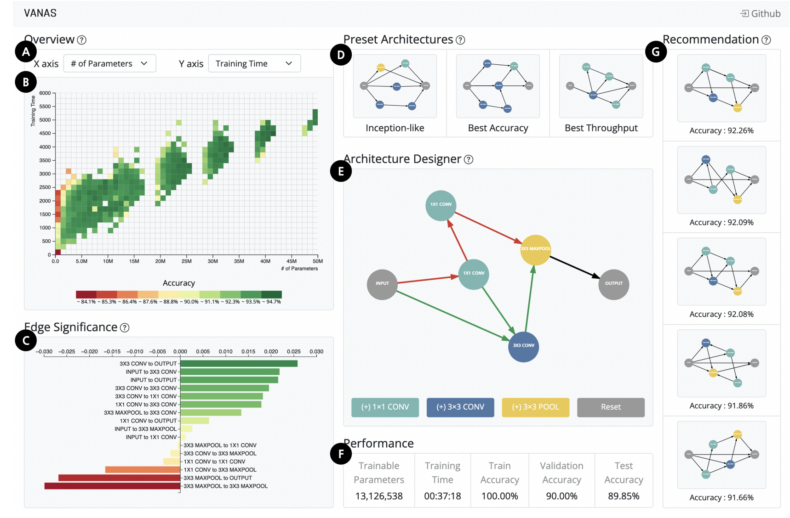 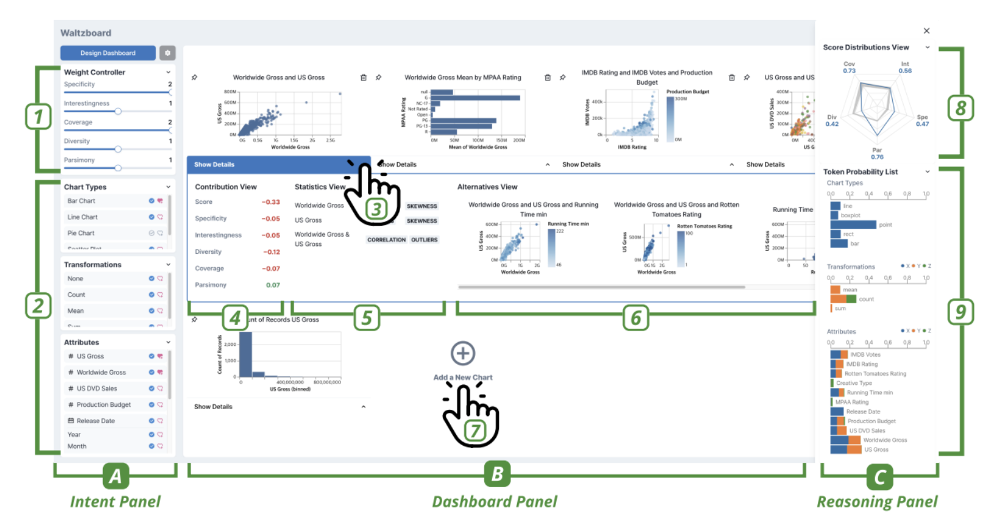

<!--
Do you remember the first time you used a visual analytics tool?

You had a dataset in front of you—but before you could explore it, you had to figure out the interface.

Which attributes should you choose? How do you create a chart? And once you have one, what should you explore next?
-->

---

<!-- _class: tool-examples overwhelmed -->

 

🤯

<!--
For beginners, getting started with data exploration can feel overwhelming.

But what if they could start exploring without first having to learn a complex interface?

What if they could use an interaction they already know?
-->

---

<!--
We propose Swipytics, a data exploration tool designed to help people learn quickly by building on knowledge they already have.

It draws on the familiar interactions of short-form video platforms, allowing users to explore data by swiping through visualizations.
-->

---

<!-- _class: metaphor -->

  

    <video class="tiktok-video" src="assets/tiktok-trimmed.mp4" poster="assets/tiktok-poster.jpg" autoplay muted loop playsinline aria-label="TikTok feed scrolling"></video>
    

  

  

Transfer Knowledge with the <strong>Same Metaphor</strong>

  

    <video class="swipytics-video" src="assets/swipytics-trimmed.mp4" poster="assets/swipytics-poster.jpg" autoplay muted loop playsinline aria-label="Swipytics chart exploration"></video>
    
Swipytics

  

<!--
Swiping and liking are things many people already know from short-form video platforms like TikTok, YouTube, and Instagram Reels.

Swipytics brings this familiar experience into data exploration. Instead of swiping through videos, users swipe through charts.

By using the same metaphor, Swipytics helps users transfer what they already know to a new context.
-->

---

<!-- _class: views overview -->
<!-- _transition: fade 0.25s -->

  
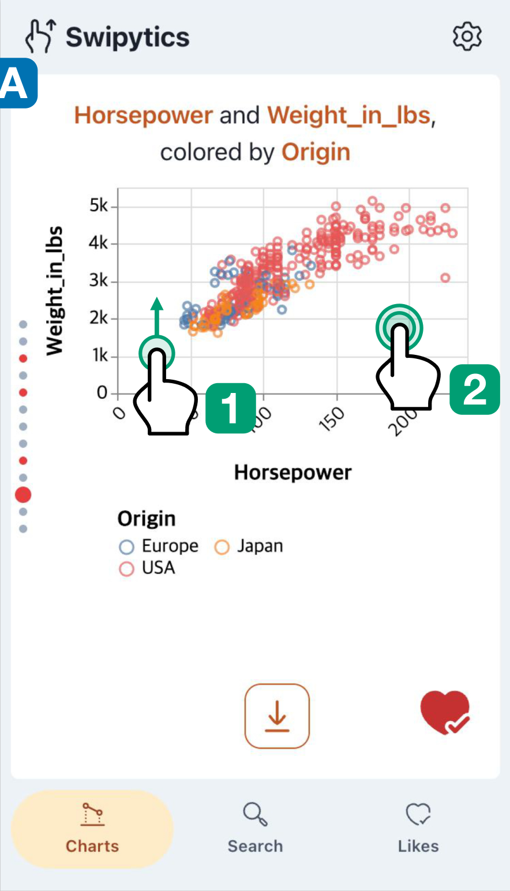Charts

  
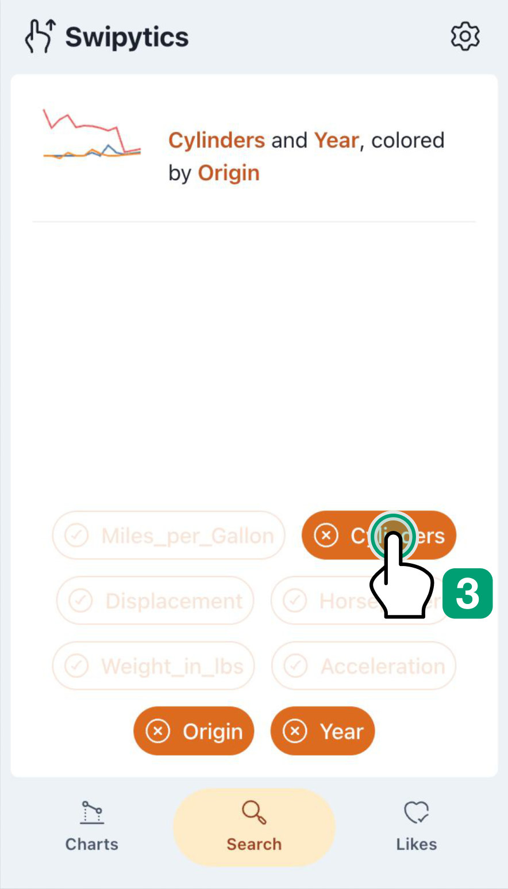Search

  
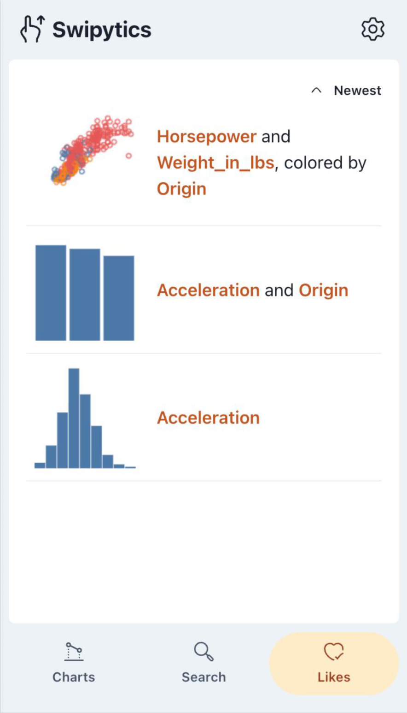Likes

<!--
Let’s take a closer look at Swipytics.

Swipytics has three views: Charts, Search, and Likes.

Let’s start with the Charts view.
-->

---

<!-- _class: dr-slide dr-one -->

# DR 1 Minimal &amp; Familiar Interactions

  

Swipe &amp; like

  

Search by tags

<!--
First, we use minimal and familiar interactions.

In the Charts view, users can swipe to see the next chart and like the ones they find interesting.

In the Search view, users can choose attributes using tags, inspired by hashtag-based search.
-->

---

<!-- _class: dr-slide dr-two -->

# DR 2 Simple Charts, at Your Own Pace

<video class="dr-video dr-tiktok-video" src="assets/tiktok-trimmed.mp4" poster="assets/tiktok-poster.jpg" autoplay muted loop playsinline aria-label="TikTok feed scrolling"></video><video class="dr-video dr-swipytics-video" src="assets/swipytics-trimmed.mp4" poster="assets/swipytics-poster.jpg" autoplay muted loop playsinline aria-label="Swipytics chart exploration"></video>

<!--
Second, we show simple visualizations at a pace users can control.

In the Charts view, users explore one visualization at a time. They can spend as much time as they need on each chart before moving on.
-->

---

<!-- _class: dr-slide dr-three -->

# DR 3 Linear Exploration with History

  

History

  

Charts

  

Revisit likes

<!--
Third, we make the exploration sequence linear.

Users move through a sequence of charts, with the history indicator showing their position. The Likes view lets users return to charts they found interesting, so they can revisit what they discovered.
-->

---

<!-- _class: attribute-selection -->

# Chart Recommendation

  

    
<strong>Relevance</strong>
Favors attributes from recent charts.

    
<strong>Preference</strong>
Favors attributes from liked charts.

    
<strong>Simplicity</strong>
Favors fewer attributes.

    
<strong>Freshness</strong>
Favors novelty, allowing revisits later.

  

  
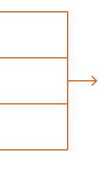Weighted score and chart mapping

  
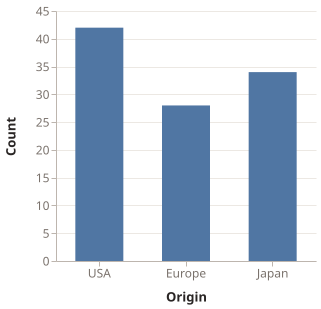

<!--
Swipytics scores candidate attribute combinations using four weighted criteria.
Relevance favors attributes from recent charts; preference considers liked charts.
Simplicity favors simpler combinations, and freshness balances unseen combinations with revisiting earlier ones.
The highest-scoring combination is then mapped to a suitable chart.
-->

---

<!-- _class: evaluation-slide -->

# Evaluation

  

    
<h2>Research Goal</h2><ul><li>Examine <strong>self-learning</strong> and <strong>exploration</strong> with Swipytics.</li></ul>

    
<h2>Study Design</h2><ul><li><strong>14 university students</strong> without visual analysis training</li><li>Self-learning with a <strong>brief tutorial sheet</strong></li><li><strong>15-minute</strong> exploration session on participants’ smartphones (11 distinct iOS/Android devices)</li></ul>

  

  
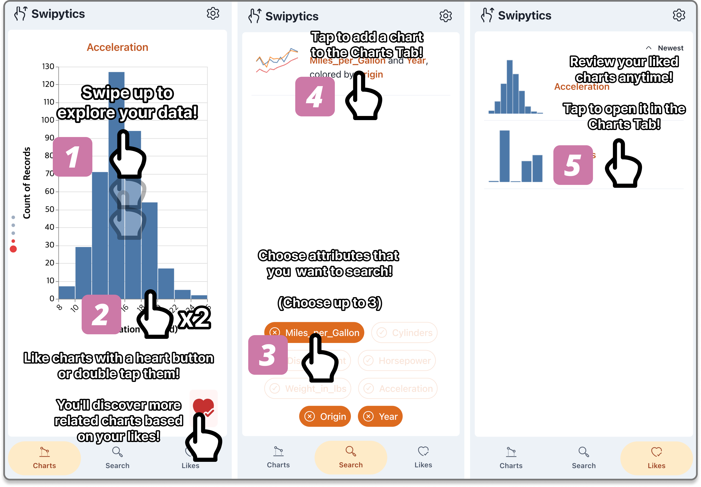Self-learning tutorial sheet

<!--
We conducted an observational study with fourteen university students using their own smartphones.
Participants first learned with the Cars dataset and a brief tutorial sheet, without verbal instruction.
They then explored the Movies dataset without specific tasks; we collected interaction logs, questionnaires, and interviews.
-->

---

<!-- _class: evaluation-slide -->

# Findings

  

High proficiency and confidence after <strong>101 seconds</strong> of self-learning

<h2>Proficiency</h2>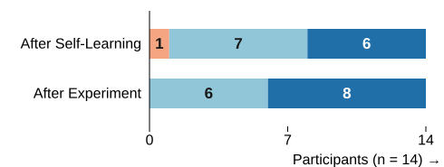

<h2>Confidence</h2>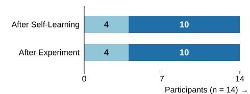

Strongly disagree<i></i><i></i><i></i><i></i><i></i>Strongly agree
Questionnaire responses · 5-point scale · n = 14

<!--
Self-learning took 101.07 seconds on average. Immediately afterward, participants rated their proficiency and confidence highly on a five-point scale. After exploration, proficiency rose slightly while confidence remained unchanged. These are self-reported ratings, not a comparison against a baseline.
-->

---

<!-- _class: evaluation-slide -->

# Findings: Usability

High usability, with a SUS score of <strong>83.75</strong>

Helpful, interpretable charts and easy smartphone use.
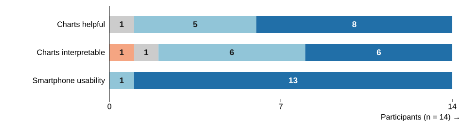
Strongly disagree<i></i><i></i><i></i><i></i><i></i>Strongly agree
Questionnaire responses · 5-point scale · n = 14

<!-- Participants rated recommendation helpfulness, chart interpretability, and smartphone usability after exploration. Counts are from the appendix questionnaire figure. -->

---

<!-- _class: evaluation-slide sequence-focus focus-p1 -->

# Findings: Exploration Patterns

<strong>Swiping</strong> supported discovery; <strong>Search</strong> enabled targeted follow-up.

<!-- P1 began with Charts and subsequently used Search alongside swiping. -->

---

<!-- _class: evaluation-slide sequence-focus focus-p10 -->

# Findings: Exploration Patterns

Participants followed <strong>different exploration patterns</strong>.

<!-- P10 predominantly used Search, showing that exploration patterns varied. -->

---

<!-- _class: evaluation-slide sequence-focus focus-p4 -->

# Findings: Exploration Patterns

A gradual shift to complex charts suggests <strong>paced exploration</strong>.

<!-- The paper reports that participants progressed from simpler to more complex charts; P4 used only the Charts tab. -->

---

<!-- _class: evaluation-slide -->

# Discussion

  
<h2>Learning <em>Independently</em></h2>
“I could work independently... without needing someone to explain things to me.”

  
<h2>Familiar <em>Interactions</em></h2>
Swiping and using Likes felt “similar to what I do in Instagram Reels.”

  
<h2>Requests for <em>Control</em></h2>
A participant wanted to configure axes manually to better examine correlations.

<!--
A participant appreciated being able to learn independently. Another compared swiping the carousel and using Likes to Instagram Reels. A participant wanted manual axis configuration to examine correlations more closely. Participants also found comparisons between non-adjacent charts challenging.
-->

---

<!-- _class: evaluation-slide -->

# Limitations

  
<h2>Comparative <em>Evaluation</em></h2>
The study did not compare Swipytics with a baseline system.

  
<h2>Dataset <em>Familiarity</em></h2>
Exploration of unfamiliar datasets requires further study.

<!--
We did not conduct a comparative evaluation against a baseline system.
The study used a familiar dataset; how the approach works for unfamiliar domains remains an open question.
-->

---

<!-- _class: conclusion-slide -->

# Conclusion

  
We bring the <strong>short-form video stream metaphor</strong> to exploratory data analysis.

  
<em>Swipytics</em> makes exploration <strong>simple, familiar, and self-paced</strong> through swiping, search, and likes.

  
Participants reported <strong>high proficiency and confidence</strong> after a brief self-learning period.

  

<strong>Jiwon Choi</strong>https://jiwnchoi.me@jiwnchoi.me @jiwnchoi 

Swipytics on GitHub

<!--
Swipytics brings the familiar short-form video stream metaphor to exploratory data analysis. It combines swiping, search, and likes to support simple, self-paced exploration. Participants reported high proficiency and confidence after a brief period of self-learning. Thank you.
-->
