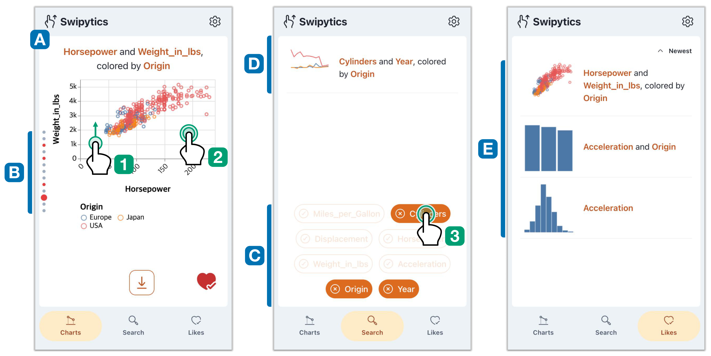
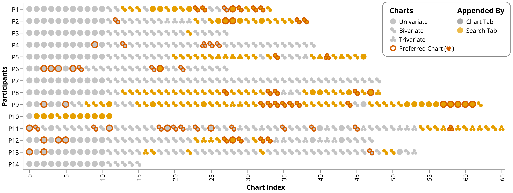

<!-- _class: title -->

## IEEE VIS / TVCG

# Swipytics: Leveraging the Short-form Video Stream Metaphor in Exploratory Data Analysis

Jiwon Choi · Sehi L'Yi · Seojin Kim · Jaemin Jo

---

<!-- _class: contents -->

# Contents

1. **Background** — Why is EDA still hard for novices?
2. **Design Rationale** — Three rationales grounded in Lam's gulfs
3. **The Swipytics Interface** — Three tabs, three interactions
4. **User Study** — 14 participants, under two minutes to proficiency
5. **Discussion** — What the metaphor buys us, and what it costs
6. **Conclusion & Future Work**

---

<!-- _class: section -->

# Background

---

# The Onboarding Barrier in EDA

- **EDA is a fundamental step in data science workflows**
  - Users iteratively manipulate and visualize data to uncover insights
- **But existing tools demand training before exploration begins**
  - Guided tutorials, interactive tours, verbal instructions lasting tens of minutes
  - We call this initial training requirement the *onboarding barrier*
- **Novices struggle on three fronts (Lam, 2008)**
  - *Gulf of execution* — translating intent into system operations
  - *Gulf of evaluation* — interpreting unfamiliar visual output
  - *Gulf of goal formation* — deciding what to analyze next

<blockquote>
<strong>Goal</strong> — Not to maximize expressive power, but to let novices start exploring immediately. 
<em>Shift cognitive effort from learning the interface to interpreting visualizations.</em>
</blockquote>

---

# Related Work at a Glance

### Barriers & Remedies
- Steep learning curves persist for novices
- Post-WIMP interactions (pen, touch, gestures, speech) reduce the gulf of execution
- But implicit interactions have low discoverability
- Visualization onboarding fills knowledge gaps

### Visualization Recommendation
- Recommending encodings: Voyager, Draco, VizML
- Recommending insights: SeeDB, ChartSeer
- History-aware recommendations refine goals
- Yet multiple simultaneous views raise cognitive load

- **Our angle** — Combine both, wrapped in a *familiar metaphor* users already know

---

<!-- _class: section -->

# Design Rationale

---

# Three Design Rationales

DR1

<strong>Use minimal and familiar interactions</strong>
A small set of short-form-video gestures shrinks the gulf of execution so users focus on EDA, not chart construction.

DR2

<strong>Show simple visualizations at a controllable pace</strong>
One univariate, bivariate, or at most trivariate chart at a time — a linear, slideshow-like pacing that avoids overload.

DR3

<strong>Make the exploration sequence linear</strong>
The system computes relationships with prior history to recommend a single next step, easing goal formation.

---

<!-- _class: section -->

# The Swipytics Interface

---

# Three Tabs, Three Interactions

<figure>

</figure>

Figure 1 — Charts Tab, Search Tab, and Likes Tab

---

# Charts Tab — Swipe as Exploration

- **One recommended chart at a time**
  - Swipe up for the next recommendation, swipe down to go back (DR1)
- **Like by double-tap or heart button**
  - Steers the recommendation engine toward related charts
- **History Indicator on the left edge**
  - Each chart is a circle; the enlarged one is current (DR3)
  - Red circles mark liked charts
- **No precomputed carousel**
  - Only the next chart is computed on the fly

Charts Tab screenshot

---

# Search & Likes Tab — Targeted and Revisitable

### Search Tab
- Data attributes act as *hashtags*
- Tap tags instead of specifying visual mappings
- Matched charts appear as a list
- Tap to append a chart to the carousel
- Avoids drag-and-drop, hard on touch devices

### Likes Tab
- Liked charts as simplified thumbnails
- Grid, axis, title, and legend omitted to aid recall
- Tap a thumbnail to jump back in the carousel
- Likes serve both bookmarking and steering

---

# Implementation — Heuristic over Heavy

### 1. Attribute Selection
- Each state = up to three attributes (DR2)
- Categorical attributes with cardinality > 10 excluded
- Scoring combines four weighted components

### 2. Visualization Mapping
- Templates indexed by attribute types
- Temporal + numeric → line chart
- Two numeric → scatterplot
- Templates built with Draco 2, stored in a hashmap

| Component | What it rewards |
| --- | --- |
| **Relevance** | Attributes shared with recent charts |
| **Preference** | Attributes from charts marked "Like" |
| **Simplicity** | Univariate states, early in exploration |
| **Freshness** | Unencountered states, then revisits |

---

<!-- _class: section -->

# User Study

---

# Study Design

14University students, 8F / 6M, ages 19–30

45Minutes, on-site, own smartphones

11Unique iOS / Android devices

2.9Mini-VLAT screening threshold (µ = 8.71)

- **Introduction (10 min)** — Demographics, consent, Mini-VLAT
- **Self-learning (up to 5 min)** — Free exploration of the Cars dataset with a lightweight tutorial sheet only
- **Exploration (15 min)** — "Comprehensively explore" the Movies dataset, no specific tasks
- **Debriefing (10 min)** — Articulated findings, SUS, custom questionnaire, interviews

---

# Results — Proficiency Came Fast

101sAverage self-learning time (σ = 18.18s)

4.29 → 4.57Perceived proficiency, before → after exploration

4.71Confidence, unchanged after exploration

- **573 charts generated** — 175 univariate, 356 bivariate, 42 trivariate
  - 72 charts liked (µ = 5.14)
  - More charts came from swiping (µ = 28.21) than from Search (µ = 12.71)
- **Ratings** — Recommendation helpfulness 4.50, interpretability 4.21, smartphone usability 4.93
- **SUS 83.75** — a "good" score, well above the 68 threshold

---

# Exploration Patterns Were Heterogeneous

<figure>

</figure>

- **Swipe-then-search** was common — discovery, then targeted follow-up
- **Exceptions existed** — P4, P7, P14 used only Charts Tab; P9 and P10 preferred Search

---

<!-- _class: section -->

# Discussion

---

# What the Metaphor Buys, and What It Costs

### Buys
- Mental models transferred from Reels and TikTok
- Algorithm behavior was readable through the History Indicator
- Likes served as both bookmark and steering signal

### Costs
- Sequential viewing beats fine-grained configuration
- Comparing non-adjacent charts stayed inefficient
- Branching and revisiting are poorly served

<blockquote>
<strong>Takeaway</strong> — The metaphor suits low-friction <em>entry</em> into EDA better than later-stage analysis.
</blockquote>

---

# Limitations & Future Work

- **No quantitative baseline**
  - Few mobile-first EDA systems mitigate the onboarding barrier comparably
- **Familiar dataset**
  - Movies dataset aided question formulation; unfamiliar domains remain untested
- **Non-expert ratings**
  - Questionnaire responses reflect perceived usefulness, not analytical quality
- **Next steps**
  - Build metaphor-free alternatives (e.g., shelf-based configuration) for direct comparison
  - Study how users form meaningful questions without domain expertise

---

<!-- _class: thanks -->

# Thanks!

Jiwon Choi · Sehi L'Yi · Seojin Kim · Jaemin Jo

`github.com/jiwnchoi/Swipytics`
